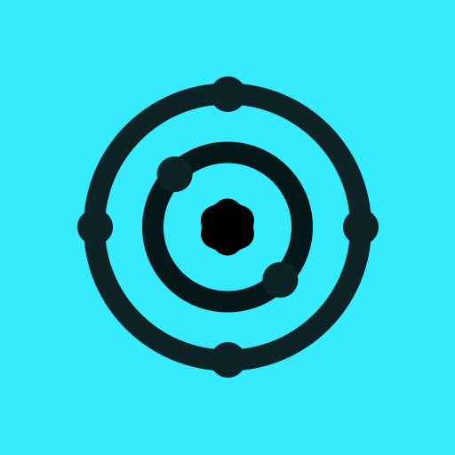

<p align="center">
    
    <h1 align="center">Valenced Website</h1>
    <p align="center">Website and documentation for Valenced. A client modification for Discord mobile.</p>
    <br>
    <div align="center">
        <a href="https://discord.com/invite/dtBTQHYSx4">
            <picture>
                <source height="32px" media="(prefers-color-scheme: dark)" srcset="https://user-images.githubusercontent.com/13122796/178032563-d4e084b7-244e-4358-af50-26bde6dd4996.png" />
                
            </picture>
        </a>&nbsp;&nbsp;&nbsp;&nbsp;&nbsp;&nbsp;
        <a href="https://github.com/Valenced">
            <picture>
                <source height="32px" media="(prefers-color-scheme: dark)" srcset="https://i.ibb.co/dMMmCrW/Git-Hub-Mark.png" />
                
            </picture>
        </a>
    </div>
</p>

## 👷 Developing

1. Install [Bun](https://bun.sh/) or [Node.js](https://nodejs.org/en/download/).
2. Clone the repository.
3. Install dependencies

    ```bash
    npm install
    # or
    bun install
    ```

4. Run development server

    ```bash
    npm run dev
    # or
    bun dev
    ```

This is a Tanstack Start application generated with [Create Fumadocs](https://github.com/fuma-nama/fumadocs).

## 📄 License

This project is licensed under the GPL-3.0 License. See [LICENSE](LICENSE) for details.
