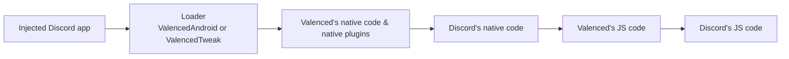

**Supercharge your Discord experience.** Valenced is a client modification for Discord mobile designed to be lightweight, customizable, and developer-friendly.

Whether you want to tweak the UI, block tracking, or load community plugins, Valenced gives you full control over your Discord mobile experience.

## How it works

Valenced injects into the official Discord app, running before Discord's own code, letting it hook into the runtime to patch functions, add features, and customize the interface.

Ready to jump in? Head over to [Installation](/docs/installation) to get set up.  
Curious about how it works under the hood? Check out [Architecture](/docs/core-development/architecture).
