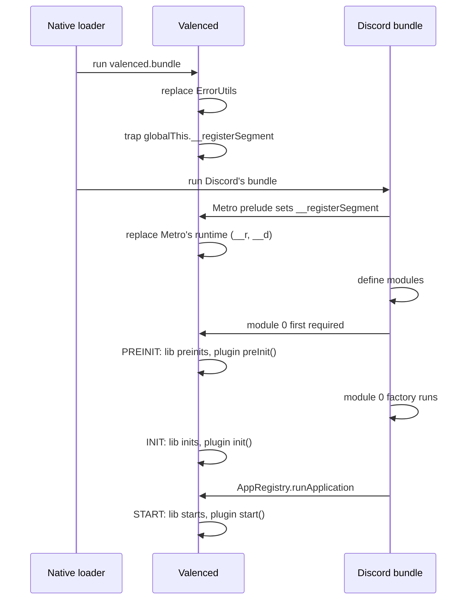

The Valenced bundle runs in the same Hermes runtime as Discord, right before Discord's bundle. It has to set itself up before Discord defines a single module, and then follow Discord's startup to know when each API becomes usable.

## Timeline

## Entry (`src/index.ts`)

The entry file does two things and nothing else:

1. **Replaces `ErrorUtils`.** React Native's JSI only needs `reportError` and `reportFatalError`. Both forward the stack to `valenced.alertError`, which shows the **Valenced Error** dialog with a Recovery button.
2. **Traps `__registerSegment`.** It defines a setter on `globalThis.__registerSegment`. Metro's prelude assigns that global after it sets `__r` and `__d`, so the setter fires at the first moment Metro's runtime exists. The setter restores the plain property and loads the preinit stage.

## Preinit stage (`src/preinit.ts`)

The preinit stage first imports `@valenced/modules/metro/patches`, which replaces Metro's `__d` and `__registerSegment` with Valenced's own [module runtime](/docs/core-development/architecture/module-system). Every module Discord defines from here on goes through Valenced.

The rest waits for `onModuleFirstRequired(0)`, the moment Discord first requires its index module:

1. Run the preinit parts of `@valenced/react`, `@valenced/assets`, and `@valenced/discord`.
2. Subscribe to `onModuleInitialized(0)` to start the init stage later.
3. Register every bundled plugin's `manifest.json` (`src/plugins/manifests.ts`), so the dependency graph knows all of them.
4. Import the preinit-stage bundled plugins (`src/plugins/preinit/*`).
5. Run `@valenced/plugins/preinit`. It registers external plugins from `valenced.plugins.list`, computes the start order, and runs `preInit` on every startable plugin.

React is not available yet. Code at this stage must not import `react` or anything that does.

## Init stage (`src/init.ts`)

The init stage runs after module 0's factory returns, when Discord's important modules exist:

1. Run the init parts of `@valenced/react` and `@valenced/json-storage`.
2. Subscribe to `onRunApplication` to start the start stage later.
3. Import the init-stage bundled plugins and run `init` on every startable plugin.

## Start stage (`src/start.ts`)

The start stage runs during `AppRegistry.runApplication`, when Discord renders its UI:

1. Run the start part of `@valenced/discord`.
2. Import the start-stage bundled plugins and run `start` on every startable plugin.

## Running plugin lifecycles

Each stage runner follows the same pattern:

1. `computePendingNodes()` adds newly registered plugins to the ordered list. API plugins come first, then plugins without dependencies, then dependents after their dependencies.
2. The runner walks the list and calls the stage's lifecycle on every plugin that `isPluginStartable` accepts.

The runner calls lifecycles in order, but does not wait for an async lifecycle to finish before calling the next plugin's.

A plugin record can exist before its implementation. `src/plugins/manifests.ts` registers every bundled manifest at preinit, but a start-stage plugin's code only registers when the start stage imports it. `isPluginStartable` requires an implementation, so each stage skips plugins that belong to later stages.

Bundled plugins live in `src/plugins/{preinit,init,start}/<name>/`, in the folder of the earliest stage they need. The stage files load each folder with `import.meta.glob`, so a new plugin needs no registration code.

See [Plugin System](/docs/core-development/architecture/plugin-system) for what happens inside each lifecycle.

## Keeping execution order

Bundlers hoist ESM imports to the top of the module, which would run every stage at once. Two build transforms keep the order written in the source:

- **`// @as-require`** above an import or `import()` turns it into a synchronous `require()` at that exact spot. The stage files use it everywhere order matters.
- **`import defer * as X`** turns a namespace import into a lazy loader. The module only runs on first property access.

See [Build](/docs/core-development/architecture/build#source-transforms) for how they work.

## Errors during boot

Valenced handles three kinds of boot failures:

- **Uncaught errors** reach the replaced `ErrorUtils` and show the **Valenced Error** dialog.
- **Module factory errors** are swallowed like Metro does, and the module gets empty exports. The runtime records the failure in `mErrorChain`. See [Module System](/docs/core-development/architecture/module-system#failed-modules).
- **Freezes**, where Discord never finishes starting, trigger the recovery plugin's freeze detection. See [Recovery](/docs/core-development/architecture/recovery#freeze-detection).

A plugin lifecycle that throws only affects that plugin. Valenced records the error, then stops and disables the plugin unless it is essential.

## Build flags

Compile-time constants gate debugging code, so release builds drop it:

| Flag | Default | Effect |
| --- | --- | --- |
| `__DEV__` | Dev builds | Development logs, hints, and dev-only plugins. |
| `__BUILD_FLAG_DEBUG_MODULE_LOOKUPS__` | Dev builds | Logs module lookups and failed finds. |
| `__BUILD_FLAG_DEBUG_MODULE_WAITS__` | Dev builds | Tracks `waitForModules` subscriptions for the hidden API. |
| `__BUILD_FLAG_DEBUG_LAZY_VALUES__` | Off | Logs lazy value evaluation. |
| `__BUILD_FLAG_LOG_PROMISE_REJECTIONS__` | Dev builds | Logs unhandled promise rejections. |

Each flag has a `VALENCED_*` environment variable that overrides the default. See [Build](/docs/core-development/architecture/build#build-constants).
