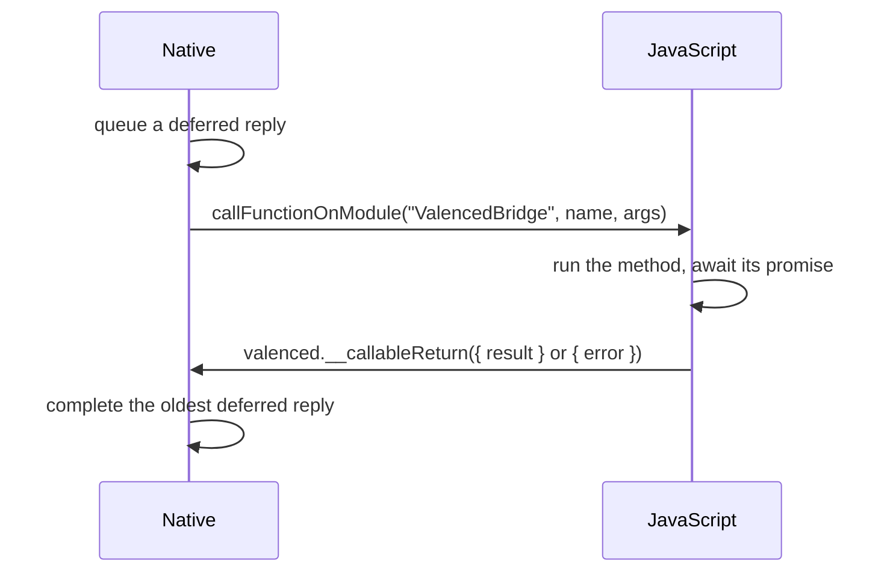

The bridge lets JavaScript call Kotlin and Kotlin call JavaScript. Native plugins, the plugin system, caches, and file access all go through it.

Valenced does not register its own React Native module. Adding one would change Discord's native module registry, which Discord's code could notice. Instead, the bridge tunnels calls through two existing modules and one existing JavaScript entry point.

## JavaScript to native

JavaScript wraps every call in a payload and passes it to an existing native module method:

```ts
{ valenced: { method: 'valenced.fs.read', args: ['/path/to/file'] } }
```

| Call | JavaScript side | Hooked native method |
| --- | --- | --- |
| Sync (`callNativeMethodSync`) | `RNSVGRenderableModule.getBBox(0, payload)` | `RNSVGRenderableManager.getBBox(Double, ReadableMap)` |
| Async (`callNativeMethod`) | `FileReaderModule.readAsDataURL(payload)` | `FileReaderModule.readAsDataURL(ReadableMap, Promise)` |

The hooks convert the `ReadableMap` to a map and look for the `valenced` key. A call without it is not ours, so the original method runs as usual. A call with it never reaches the original method.

The hook answers with one of two shapes:

```ts
{ result: unknown }  // the handler's return value
{ error: string }    // the stack trace of what the handler threw
```

`callNativeMethod` and `callNativeMethodSync` unwrap the result, or throw an `Error` with the native stack trace.

A sync call blocks the JavaScript thread until native answers. Use it only where async is impossible, such as module-scope code at boot.

### Registering methods

Native code registers handlers on `ValencedBridge`, usually through the `HostScope` shorthands:

```kotlin
registerNativeMethod("my.method") { args -> mapOf("echo" to args) }

registerNativeAsyncMethod("my.slowMethod") { args ->
    withContext(Dispatchers.IO) { readSomething(args) }
}
```

- **Sync handlers** run on the thread that made the call: the JavaScript thread for sync calls, or React Native's native modules thread for async ones. Keep them quick.
- **Async handlers** are suspending functions. They run on a background coroutine scope and resolve the promise when done. They can do disk and network work, and call back into JavaScript.
- An async handler is only reachable through `callNativeMethod`. A sync call to it fails with `Native bridge method is async-only`.

Return values go through React Native's `Arguments.makeNativeObject`, so maps, lists, strings, numbers, booleans, and `null` cross the bridge. `Unit` becomes `null`.

### Typing methods

JavaScript types each method through declaration merging on `NativeMethods`:

```ts
declare module '@valenced/modules/native' {
    interface NativeMethods {
        'valenced.fs.read': [[path: string], string]
    }
}
```

The first tuple holds the argument types and the second holds the result type.

## Native to JavaScript

At startup, the bundle registers a callable module named `ValencedBridge` with `RN$registerCallableModule`. It is a proxy over every method registered through `registerJSMethod`.

Native calls it through `ReactInstance.callFunctionOnModule("ValencedBridge", name, args)`. The bridge captures the `ReactInstance` when React Native constructs it.

React Native's callable modules return nothing, so replies take a second trip:



- `callJSMethod` suspends until the reply arrives, and throws when JavaScript answers with an error.
- Replies match calls by position. Native queues the deferred reply and makes the call under one lock, so the queue order always matches the call order.
- `bridge.isReady` tells whether JavaScript can be reached yet. Before the bundle registers its callable module, `callJSMethod` throws.
- An unknown method name throws inside the JavaScript runtime, where native can't catch it. Only call methods you know JavaScript registered.

## Plugin system methods

Every `valenced.plugins.*` method wraps its answer in a second envelope, inside the bridge's own:

```ts
{ result: T }
{ error: { code: string, message: string, stack?: string, details?: unknown } }
```

Native handlers throw `PluginException(code, message)`. The `pluginSystemMethod` and `pluginSystemAsyncMethod` registration wrappers turn it into the error envelope. JavaScript calls these methods through `callPluginSystemMethod`, which unwraps the envelope and throws a `PluginSystemError` with the code.

The two envelopes mean different things:

- The bridge's `{ error }` is a transport problem, such as a missing method or bad arguments. It is a bug.
- The plugin system's `{ error }` is a refusal with a reason, such as `DEPENDENCIES_UNSATISFIED`. The UI can branch on the code and show the message.

## Events

Native also pushes events to JavaScript by calling JavaScript methods named `valenced.plugins.events.*`. Events are fire-and-forget. One can arrive before or after the bridge call that caused it resolves.

That leads to one rule: **a call returns its own results.** Events only carry changes JavaScript didn't start. For example, `valenced.plugins.uninstall` answers with the restored stub plugin instead of emitting an event, since JavaScript is waiting on that call.

## Method inventory

Methods JavaScript calls on native. **Sync** handlers answer both call styles. **Async** handlers only answer `callNativeMethod`.

| Method | Kind | Purpose |
| --- | --- | --- |
| `valenced.info` | Sync | Loader name and version. |
| `valenced.alertError` | Sync | Shows the **Valenced Error** dialog with a stack trace. |
| `valenced.showRecoveryAlert` | Sync | Opens the recovery options. |
| `valenced.app.reload` | Sync | Restarts the app. |
| `valenced.fs.read`, `write`, `exists`, `delete`, `getConstants` | Sync | Text file access by absolute path, or relative to the data directory. |
| `valenced.caches.modules.*`, `valenced.caches.assets.*` | Sync | Reads and writes the finder and asset caches. |
| `valenced.themes.getState`, `setColors`, `setFonts`, `setIcons` | Sync | Theme selections. See [Themes](/docs/core-development/architecture/themes). |
| `valenced.plugins.list`, `getConstants` | Sync | Plugin payloads and plugin paths at boot. |
| `valenced.plugins.states.*` | Sync | Plugin state slots. See [Plugin States](/docs/core-development/architecture/plugin-states). |
| `valenced.plugins.setEnabled`, `setHeld`, `stop`, `restart`, `uninstall` | Async | Plugin management. |
| `valenced.plugins.installFile` | Sync | Opens the system file picker to sideload a ZIP. |
| `valenced.plugins.confirmInstallFile` | Async | Applies or discards a staged sideload. |
| `valenced.plugins.planInstall`, `install`, `listUpdates`, `repos.*` | Async | Repositories, installs, and updates. |

Methods native calls on JavaScript:

| Method | Purpose |
| --- | --- |
| `valenced.plugins.stopping` | Asks JavaScript to stop its half of a plugin first. |
| `valenced.plugins.states.update` | Pushes a flag change in a slot. |
| `valenced.plugins.events.pluginInstallResult` | A fresh install registered. |
| `valenced.plugins.events.pluginUpdated` | An update of an installed plugin landed on disk. |
| `valenced.plugins.events.pluginInstallFileReady` | A sideloaded ZIP is staged and needs confirmation. |
| `valenced.plugins.events.dependenciesUpdated` | Unsatisfied optional dependencies changed after an install or uninstall. |
| `valenced.plugins.events.pluginErrored` | A running native half reported errors. |
| `valenced.plugins.events.downloadProgress` | Artifact download progress. |
| `valenced.plugins.events.repoStateUpdate` | A repository started or finished refreshing. |
