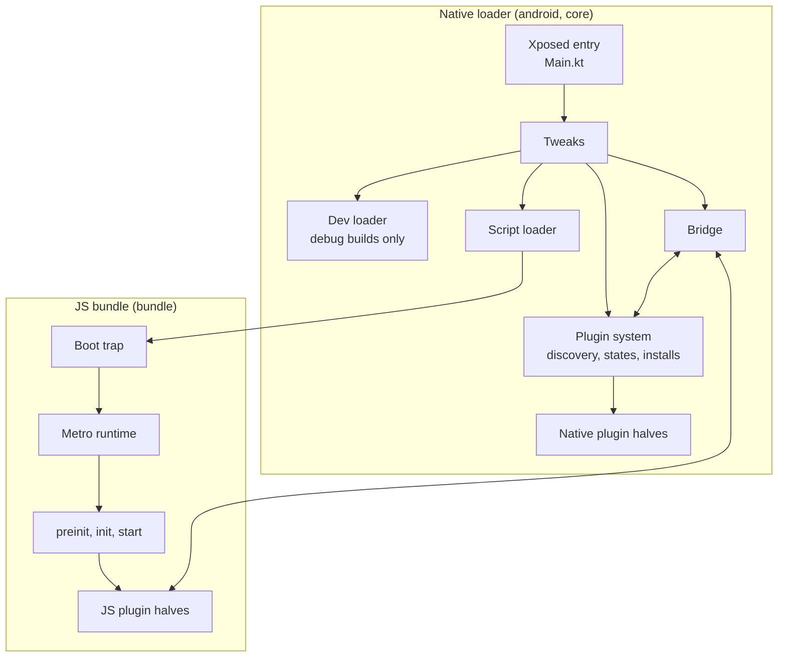

Valenced runs inside the official Discord app. It has two halves that start in different worlds and talk over a bridge:

1. **The native loader**. Code that runs inside Discord's process. On Android, it is a Kotlin Xposed module (`android/`). On rooted devices, an Xposed framework such as Vector injects it. Valenced Manager embeds the same loader into a patched Discord APK for non-root installs. On iOS, it is a tweak (`ios/`).
2. **The JS bundle** (`bundle/`). TypeScript compiled to Hermes bytecode. The loader runs it in Discord's own JavaScript runtime, right before Discord's bundle.

Both halves share one plugin system. A plugin can have a native half, a JavaScript half, or both, with one manifest and one set of states.

Everything lives in one monorepo, [Valenced/valenced](https://github.com/Valenced/valenced), built with Gradle:

| Module | Language | Holds |
| --- | --- | --- |
| `:bundle` (`bundle/`) | TypeScript, Deno | The JS bundle. Every loader build ships it. |
| `:core` (`core/`) | Kotlin Multiplatform | Code both loaders share: plugin manifests, versions, states, repositories, and dependency resolution. |
| `:android` (`android/`) | Kotlin | The Android loader, an Xposed module. |
| `:android:api` (`android/api/`) | Kotlin | The public API native Android plugins compile against. |
| `:ios` (`ios/`) | Objective-C, Logos | The iOS loader, a tweak that links `:core` as a static library. |

This section describes the Android loader. The iOS loader follows the same design and shares `:core`.

## Pipeline

At a high level, a cold start goes like this:

1. Xposed loads the module into Discord's main process, and the loader applies its tweaks in order.
2. The plugin system reads plugin states, discovers installed plugins, and starts the native halves of enabled plugins.
3. React Native asks to load Discord's bundle. The script loader runs the Valenced bundle shipped in the loader first.
4. The Valenced bundle replaces Metro's module runtime, then waits for Discord's index module.
5. Valenced runs the `preInit`, `init`, and `start` lifecycles of JavaScript plugins as Discord boots.

## Who owns what

The two halves split responsibilities on purpose:

| Concern | Owner | Why |
| --- | --- | --- |
| Plugin discovery, files, installs, and updates | Native | It runs first, and it can reach the file system and network without the bridge. |
| Plugin states and persistence | Native | Native must decide what to load before any JavaScript runs. |
| Version parsing and dependency resolution | Native | One implementation, used at boot, on install, and on enable. |
| Plugin UI, update policy, and user choices | JavaScript | It renders the UI and knows what the user is doing. |
| JavaScript lifecycles and the stop cascade | JavaScript | JavaScript cleanups can call into native, so JavaScript tears down first. |

A few rules hold across every system:

- **Nothing replaces running code.** Plugin updates land on disk and load on the next reload.
- **Releases never load remote code.** The bundle is built into each loader release, and only debug builds can load a development bundle.
- **Native never runs plugin JavaScript.** It hands scripts to the bundle, which evaluates them lazily.
- **Bridge methods are granular.** One method does one operation on one target. JavaScript composes them.
- **Hot paths are tuned for Hermes.** The module runtime, finders, and patcher use bitflags, indexed loops, and stable object shapes.

## Systems

<Cards>
    <Card href="/docs/core-development/architecture/native-loader" />
    <Card href="/docs/core-development/architecture/bridge" />
    <Card href="/docs/core-development/architecture/boot-sequence" />
    <Card href="/docs/core-development/architecture/module-system" />
    <Card href="/docs/core-development/architecture/patcher" />
    <Card href="/docs/core-development/architecture/plugin-system" />
    <Card href="/docs/core-development/architecture/plugin-states" />
    <Card href="/docs/core-development/architecture/repositories" />
    <Card href="/docs/core-development/architecture/recovery" />
    <Card href="/docs/core-development/architecture/themes" />
    <Card href="/docs/core-development/architecture/build" />
</Cards>

## Where the code lives

Native paths are relative to `android/src/main/kotlin/app/valenced/xposed/` unless they start with a module directory. `core/.../` is `core/src/commonMain/kotlin/app/valenced/`, and `android/api/.../` is `android/api/src/main/kotlin/app/valenced/`.

| System | Native (`android/`, `core/`) | JavaScript (`bundle/`) |
| --- | --- | --- |
| Native loader | `Main.kt`, `Tweak.kt`, `tweaks/` | |
| Bridge | `tweaks/bridge/`, `android/api/.../bridge/ValencedBridge.kt` | `lib/modules/src/native/` |
| Boot sequence | `tweaks/base/ScriptLoader.kt`, `tweaks/ValencedScriptLoader.kt` | `src/index.ts`, `src/preinit.ts`, `src/init.ts`, `src/start.ts` |
| Module system | `tweaks/Caches.kt` | `lib/modules/src/` |
| Patcher | | `lib/patcher/src/` |
| Plugin system | `core/.../plugins/`, `tweaks/plugins/`, `android/api/.../plugins/` | `lib/plugins/src/`, `src/plugins/` |
| Repositories | `core/.../plugins/repos/`, `tweaks/plugins/repos/` | `lib/plugins/src/_internal/repositories.ts` |
| Recovery | `tweaks/RecoveryCompanion.kt`, `tweaks/plugins/internal/RecoveryPlugin.kt` | `src/plugins/preinit/recovery/` |
| Themes | | Stubs in `src/plugins/preinit/api.themes/` and `src/plugins/start/settings.themes/`. The plugins live in `valenced-community-plugins`. |
| Build | `android/build.gradle.kts`, `bundle/build.gradle.kts` | `scripts/` |
