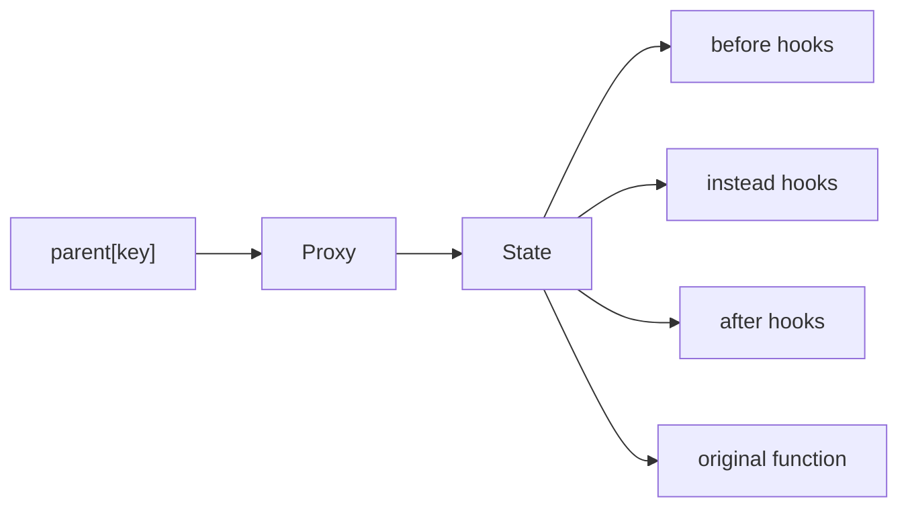

`@valenced/patcher` hooks functions and constructors on any object. Plugins use it through `before`, `instead`, and `after`. The implementation lives in `lib/patcher/src/`.

## One proxy per patched function

The first hook on `parent[key]` replaces the function with a `Proxy`:

- The proxy's target is a **state object** that holds the original function, the parent, the key, and three hook lists.
- A `WeakMap` maps each proxy to its state. A second hook on the same `parent[key]` finds the existing state and adds to its lists, so a function never gets wrapped twice.
- Every trap other than `apply` and `construct` forwards to the original function. Reading properties, `instanceof` checks, and prototypes behave like the unpatched function.

Patching through the proxy keeps the cost per call low: one proxy dispatch and a walk over short linked lists.

## Calling a patched function

The `apply` trap, and the `construct` trap for `new`, run the hooks in three steps:

1. **Before hooks** each receive the argument list and return the one to pass on.
2. **Instead hooks** replace the call. Each one receives the arguments and the next function in the chain. The last instead hook's next function is the original. Without instead hooks, the original runs directly.
3. **After hooks** each receive the result and return the one to pass on.

## Hook lists and priority

Each hook kind is a doubly linked list of nodes, sorted by `priority` (`HookPriority.LOWEST` to `HIGHEST`, default `NORMAL`):

| Kind | Order | Effect of high priority |
| --- | --- | --- |
| Before | Ascending | Runs last, so it has the final say on the arguments. |
| Instead | Descending | Runs first, as the outermost wrapper. |
| After | Descending | Runs first, closest to the original result. |

Hooks never see their own list nodes. The runner reads `next` before calling a hook, so a hook can unpatch itself while it runs.

## Unpatching

Every hook function returns an unpatch function:

1. It marks the node as unpatched, so calling it twice does nothing.
2. It unlinks the node from its list.
3. When all three lists are empty, it restores the original function on the parent and drops the state.

Step 3 only restores the original when `parent[key]` still holds the proxy. If other code replaced the property in the meantime, the patcher leaves it alone.

## Patching the right object

The patcher replaces a property on the object you pass. Code that already holds a reference to the original function keeps calling it.

This matters for Discord's modules. The [module runtime](/docs/core-development/architecture/module-system#why-replace-metros-runtime) never clones exports, and Discord's transpiled code reads `exports.Foo` at call time. So a patch on a module's exports object reaches every importer.

A patch on a re-export only reaches code that reads that re-export. Patch the source module where you can.
