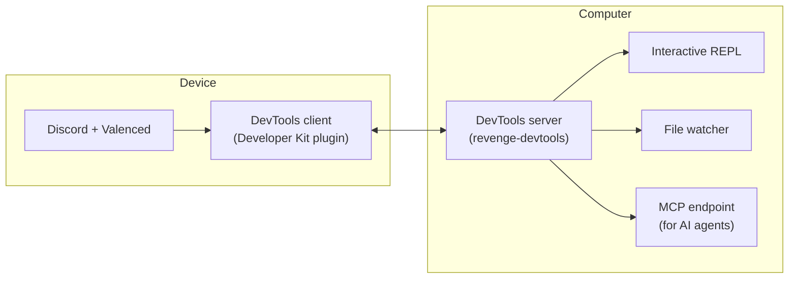

Valenced Developer Tools (DevTools) connects a running Discord client to a server on your computer over WebSocket. It enables remote code execution, module inspection, file watching, and log streaming in real time.



## Packages

DevTools contains three packages:

| Package | Purpose |
| --- | --- |
| [`@revenge-mod/devtools-server`](https://github.com/revenge-mod/revenge-devtools/tree/main/packages/server) | WebSocket server and interactive terminal CLI. |
| [`@revenge-mod/devtools-client`](https://github.com/revenge-mod/revenge-devtools/tree/main/packages/client) | Client library, used by the Developer Kit plugin. |
| [`@revenge-mod/devtools-shared`](https://github.com/revenge-mod/revenge-devtools/tree/main/packages/shared) | Shared types, constants, and utilities. |

<Callout title="Still named Revenge">
    The DevTools packages and the `revenge-devtools` command keep their Revenge names for now. They work with Valenced as is. Code you evaluate can use both the `valenced` and `revenge` globals.
</Callout>

Install the server CLI:

```sh
bun install --global @revenge-mod/devtools-server
revenge-devtools
```

To connect from your device, open **Settings > Valenced > Developer > Connect to DevTools**. The Developer Kit plugin (`valenced.developer-kit`) manages the connection. Install it from the official plugin repository in **Browse Plugins**.

## Capabilities

- Run JavaScript remotely on connected clients from the server terminal.
- Inspect variables and exposed scope in the client runtime.
- Watch build directories and trigger commands on change, such as reloading Discord.
- Stream client logs to your local terminal.
- Connect AI coding agents to the client through the built-in [MCP server](/docs/devtools/features#mcp-server).

For command details, see [Features](/docs/devtools/features) and the [Usage Guide](/docs/devtools/usage-guide).
