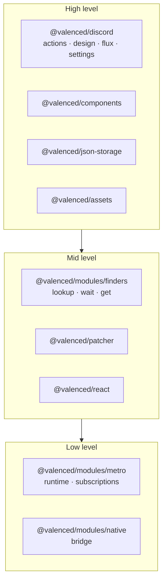

The Valenced plugin API consists of `@valenced/*` packages. At runtime, the packages attach to the global `valenced` object and pass into plugins via `api.unscoped`.

## Package overview

| Package | Description | Reference |
| --- | --- | --- |
| `@valenced/plugins` | Plugin types, constants, and lifecycle interfaces. | [Lifecycles](/docs/plugin-development/api-reference/lifecycles), [Plugin API](/docs/plugin-development/api-reference/plugin-api) |
| `@valenced/patcher` | Method hooking with `before`, `after`, and `instead` hooks. | [Patcher](/docs/plugin-development/api-reference/patcher) |
| `@valenced/modules` | Module finders, Metro runtime inspection, and filter generators. | [Modules](/docs/plugin-development/api-reference/modules) |
| `@valenced/json-storage` | Persistent JSON storage with React hook integration. | [JSON Storage](/docs/plugin-development/api-reference/storage) |
| `@valenced/discord` | High-level Discord APIs (actions, design system, Flux stores, settings, native modules). | [Discord](/docs/plugin-development/api-reference/discord) |
| `@valenced/assets` | Discord asset registry lookups, custom asset registration, and asset overrides. | [Assets](/docs/plugin-development/api-reference/assets) |
| `@valenced/react` | React instances, React Native modules, and JSX runtime patching. | [React](/docs/plugin-development/api-reference/react) |
| `@valenced/components` | Reusable UI components matching Discord design patterns. | [Components](/docs/plugin-development/api-reference/components) |
| `@valenced/externals` | Bundled third-party libraries (FlashList, React Navigation, bottom sheets, NetInfo). | [Externals](/docs/plugin-development/api-reference/externals) |
| `@valenced/utils` | Bit set, callback, object, promise, proxy, tree, and React fiber helpers. | [Utils](/docs/plugin-development/api-reference/utils) |
| `@valenced/modules/native` | Native bridge interface for Kotlin loader communication. | [Native Bridge](/docs/plugin-development/api-reference/native) |
| `@valenced/hidden` | Internal interfaces and runtime debugging hooks (requires Developer Mode). | [Hidden API](/docs/plugin-development/api-reference/hidden) |

Plugins that depend on the `valenced.api.themes` plugin also get `api.themes` for providing color themes, font packs, icon packs, and emoji packs. Plugins that depend on `valenced.settings.plugins` get [`api.pluginSettings`](/docs/plugin-development/api-reference/plugin-api#pluginsettings-from-valencedsettingsplugins) for the plugin management UI. See [Themes](/docs/plugin-development/api-reference/themes).

## API layers

- **High level:** Curated APIs maintained across Discord updates.
- **Mid level:** Module finders and function patcher for unexposed internals.
- **Low level:** Metro runtime hooks and raw native bridge methods.

## Availability by lifecycle

APIs become available as the boot sequence advances across lifecycle stages (`PreInitPluginApi`, `InitPluginApi`, `PluginApi`):

| API | `preInit` | `init` | `start` / `stop` |
| --- | :-: | :-: | :-: |
| `patcher`, `modules`, `plugins`, `assets`, `externals`, `utils` | Available | Available | Available |
| `react`, `discord` (most submodules) | Available | Available | Available |
| `discord.{actions,common,components,design}` | Unavailable (throws) | Available | Available |
| `utils.discord` | Unavailable (throws) | Available | Available |
| `jsonStorage` (via Plugin API plugin) | Declared | Available | Available |
| `logger` (via Plugin API plugin) | Unavailable | Available | Available |
| `themes` (via Themes API plugin, dependents only) | Available | Available | Available |
| `JsonStorage#use()` React hook | Unavailable | Available | Available |

Accessing an uninitialized API before its supported stage throws a runtime error.

## Hidden and internal APIs

Enabling **Developer Mode** in Valenced settings exposes internal interfaces under `@valenced/hidden` to plugins that declare a dependency on `valenced.api.hidden`.
The hidden API provides access to Valenced internals for advanced debugging and experimental APIs. See [Hidden API](/docs/plugin-development/api-reference/hidden) to learn more.
