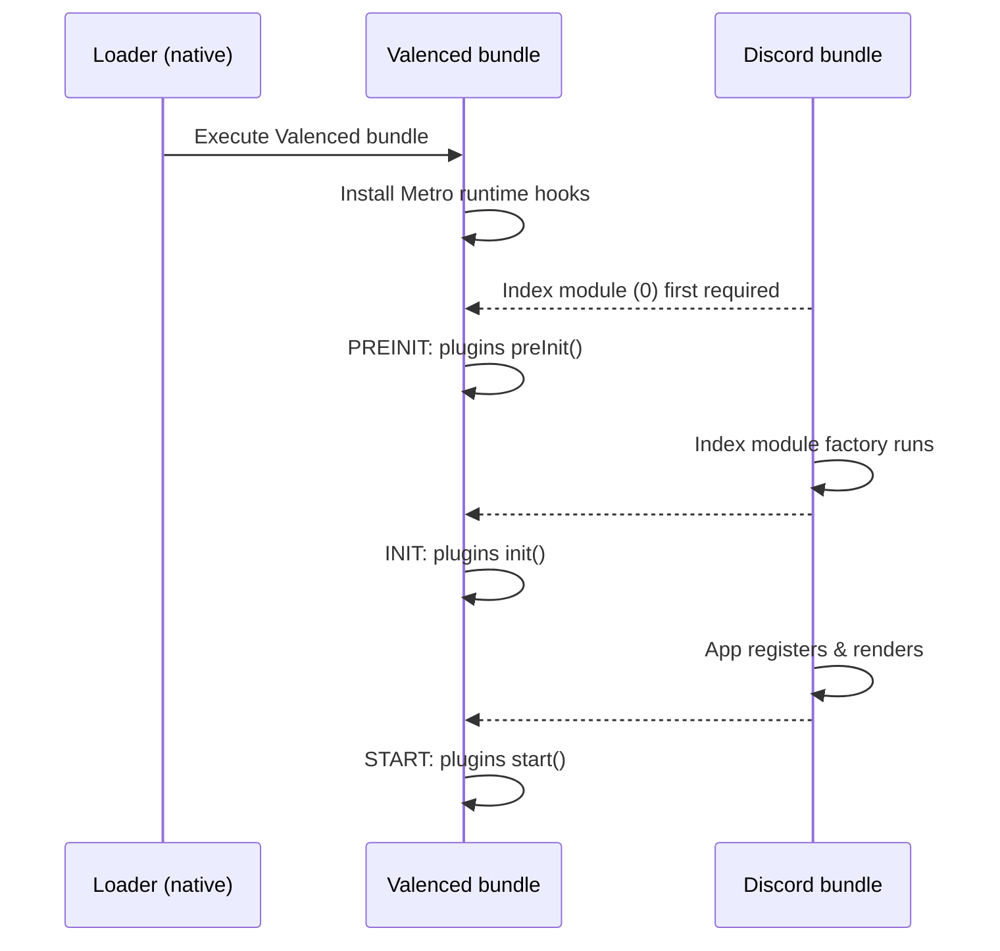

## Lifecycle stages

```ts
interface PluginLifecycles {
    /**
     * Runs as soon as possible with very limited APIs.
     * Before the index module (module 0)'s factory is run.
     *
     * @param api Plugin API (very limited).
     */
    preInit?(api: PreInitPluginApi): any
    /**
     * Runs as soon as all important modules are initialized.
     * After the index module (module 0)'s factory is run.
     *
     * @param api Plugin API (limited).
     */
    init?(api: InitPluginApi): any
    /**
     * Runs during the `AppRegistry.runApplication` call,
     * when the plugin can be started with all APIs available.
     *
     * @param api Plugin API.
     */
    start?(api: PluginApi): any
    /**
     * Runs when the plugin is stopped.
     *
     * @param api Plugin API.
     */
    stop?(api: PluginApi): any
}
```

### Execution timeline



- **`preInit`:** Runs as soon as possible with very limited APIs, before the index module (0)'s factory is run. Used for early startup patches and telemetry blockers.
- **`init`:** Runs as soon as all important modules are initialized, after the index module (0)'s factory is run. React and core libraries are ready before UI components mount.
- **`start`:** Runs during the `AppRegistry.runApplication` call, when the plugin can be started with all APIs available. Standard plugin initialization and event subscriptions run here.
- **`stop`:** Runs when the plugin is stopped. Registered cleanups execute automatically in reverse order.

## Execution order and cascading

Plugins start in dependency order: dependencies run each lifecycle stage before their dependents. The startup sequence is computed from the manifest dependency graph.

When a plugin stops or is disabled, active dependent plugins stop first in reverse dependency order:

| Trigger | Required dependents | Linked optional dependents | Unlinked optional dependents |
| --- | --- | --- | --- |
| User disables or uninstalls plugin | Stopped and disabled | User picks: restarted without it, or stopped and disabled | Untouched |
| Plugin calls its own `stop()` | Stopped only | Stopped only | Untouched |

An optional dependent is **linked** when the dependency was running as the dependent started. A dependent that started without it is unlinked, and stays unlinked until it restarts.

When a user enables a plugin, Valenced offers to restart running dependents that started without it, so they can pick it up.

## Late starts

When a plugin starts after initial boot (such as when the user enables a freshly installed plugin, or starts one from its options), Valenced sets `plugin.startedLate = true` and executes `preInit`, `init`, and `start` sequentially in immediate succession.

## The `Plugin` instance

The `api.plugin` object exposes metadata and state control:

```ts
interface Plugin {
    manifest: PluginManifest
    lifecycles: PluginLifecycles
    startedLate: boolean
    errors: readonly unknown[]
    reportError(e: unknown): void  // records an error without stopping the plugin
    SettingsComponent?: FC<{ api: PluginApi }>

    disable(): Promise<void>  // disables plugin and stops running dependents
    stop(): Promise<void>     // stops plugin without updating persisted state
    requireReload(): void     // flags that changes require an app reload to undo
}
```

Call `requireReload()` when a plugin modifies runtime state that cannot be reverted mid-session.

`reportError()` records an error and shows it in the plugin's options. It does not disable or stop the plugin. Call `stop()` or `disable()` after it if the error is fatal. A lifecycle that throws always stops and disables the plugin.

<Callout title="Stop timeout">
    Plugin teardown uses a 5-second timeout. If cleanup tasks do not complete within 5 seconds, Valenced aborts the wait and flags the plugin as requiring a reload. Teardown routines should remain synchronous where possible.
</Callout>
