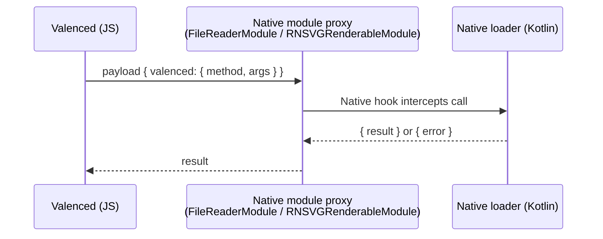

`@valenced/modules/native` provides JavaScript communication with the native loader. In non-root setups, Valenced Manager bundles this loader directly into the patched Discord APK.

```ts
import {
    getNativeModule,
    callNativeMethod,
    callNativeMethodSync,
    registerJSMethod,
    getBridgeInfo,
} from '@valenced/modules/native'

const info = getBridgeInfo() // { name: string, version: number } | null

await callNativeMethod('valenced.alertError', [stack, version])
```

## How the bridge works

The bridge routes calls to the native loader through intercepted native module method invocations:



## Built-in native methods

| Method | Purpose |
| --- | --- |
| `valenced.info` | Loader name and bridge version. |
| `valenced.alertError` | Displays native error alert dialog. |

## Custom native methods

Declare custom method signatures using TypeScript declaration merging:

```ts
declare module '@valenced/modules/native' {
    export interface NativeMethods {
        'my.method': [[arg1: string, arg2: number], ReturnedType]
    }
}
```

Native plugins register matching handlers in Kotlin, and JavaScript calls them through `callNativeMethod`:

```kotlin
import app.valenced.xposed.api.registerNativeMethod
import app.valenced.xposed.api.registerNativeAsyncMethod

val myPlugin = plugin {
    start {
        // Runs on the React Native modules thread. Keep it quick.
        registerNativeMethod("my.method") { args -> "Hello, ${args[0]}" }

        // Suspending handler for disk or network work
        registerNativeAsyncMethod("my.slowMethod") { args -> fetchSomething(args) }
    }
}
```

An async method can only be reached through `callNativeMethod`, not `callNativeMethodSync`.

### Calling JavaScript from Kotlin

JavaScript plugins can expose functions to native code using `registerJSMethod`:

```ts
registerJSMethod('myPlugin.ping', () => 'pong')
```

Kotlin calls it with the suspending `callJSMethod`. JavaScript may not be running yet, such as early in boot. Check `bridge.isReady` first, since `callJSMethod` throws when JavaScript can't be reached:

```kotlin
import app.valenced.xposed.api.callJSMethod

if (bridge.isReady) {
    val reply = callJSMethod("myPlugin.ping")
}
```

## Finding obfuscated code

Discord 352.2 and later ship with R8 renaming, so most of Discord's own class and member names change between builds. Native plugins find them with `dexFinder`, which `PluginScope` provides. It wraps [DexKit](https://github.com/LuckyPray/DexKit) and is available in every Valenced API version:

```kotlin
val myPlugin = plugin {
    start {
        // Finds the method by a string only it uses
        val method = dexFinder.findMethod {
            matcher { usingStrings("a string only this method uses") }
        }

        method?.hook { /* ... */ }
    }
}
```

- `findClass`, `findMethod`, and `findField` take a DexKit query. Each returns `null` unless exactly one result matches. Methods and fields come back accessible.
- Results are cached per Discord APK, so later launches skip the scan. Misses are cached too.
- These three key the cache by the query's content. Plugins that make the same query share one result.
- `findString(key)` reads a string from the dex, such as a constant R8 inlined. `findValue(key, encode, decode)` covers queries that need code DexKit can't express. Both take a `key` that Valenced scopes to your plugin ID and version.
- `findMethod` can't return constructors.

Lookups made during `start` share one DexKit bridge. Later lookups that miss the cache open their own, which is slower.

<Callout title="Prefer kept names">
    Some names survive R8, such as JNI `native` methods, `@DoNotStrip` members, native modules and their `@ReactMethod`s, view managers, and manifest components. Use those directly when you can. Good anchors for queries are unique strings, `toString` prefixes of data classes, Kotlin null-check parameter names, enum constant names, and calls to or from kept methods.
</Callout>

Never use DexKit directly. Its native library only loads in the Valenced loader, so call it through `dexFinder`.

## Plugin files

Files under `assets/` in your plugin ZIP are unpacked with the plugin. Native code reads them through `pluginDir`:

```kotlin
start {
    val text = File(pluginDir, "assets/test.txt").readText()
}
```

JavaScript reads the same files with `readFileSync` from `@valenced/modules/native/fs`, under [`pluginDistDirFor(id)`](/docs/plugin-development/api-reference/plugin-api#pluginsconstants):

```ts
import { readFileSync } from '@valenced/modules/native/fs'
import { pluginDistDirFor } from '@valenced/plugins/constants'

const text = readFileSync(`${pluginDistDirFor('com.example.plugin')}/assets/test.txt`)
```

These helpers read text only. A binary file read as text comes back mangled.

Updates replace these files. Write runtime data to your plugin's storage directory instead (`storageDir` in Kotlin, `pluginStorageDirFor(id)` in JavaScript).

## Filesystem helpers

`@valenced/modules/native/fs` reads and writes text files through the native loader:

```ts
import { readFile, writeFile, exists, rm } from '@valenced/modules/native/fs'

await writeFile(`${dir}/notes.txt`, 'hello') // creates parent directories
const text = await readFile(`${dir}/notes.txt`)
await exists(`${dir}/notes.txt`)
await rm(dir) // deletes directories recursively
```

Each helper also has a synchronous variant (`readFileSync`, `writeFileSync`, `existsSync`, `rmSync`). Use [`pluginStorageDirFor`](/docs/plugin-development/api-reference/plugin-api#pluginsconstants) to get your plugin's data directory.

## App helpers

`@valenced/modules/native/app` controls the app itself:

```ts
import { reloadApp } from '@valenced/modules/native/app'

reloadApp()
```

<Callout type="warn">
    Synchronous calls block the JS thread until the native side responds. Use `callNativeMethodSync` only when asynchronous execution is impossible (such as early startup phases).
</Callout>
