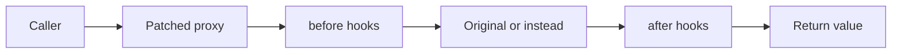

`@valenced/patcher` intercepts function calls on target objects.

```ts
import { after, before, instead, HookPriority } from '@valenced/patcher'
```

Each patcher method returns an unpatch callback:

```ts
const unpatch = before(parent, key, hook, { priority: HookPriority.NORMAL })
unpatch() // unregisters hook
```

Parameters:

- `parent`: Target object holding the method.
- `key`: Method property name on `parent`.
- `hook`: Callback function.
- `options.priority`: Optional number or `HookPriority` enum member. Lower values execute earlier in before hooks (default: `HookPriority.NORMAL` / `0`).

Available `HookPriority` levels:

| Constant | Value | Ordering |
| --- | --- | --- |
| `HookPriority.LOWEST` | `-1000` | Executes earliest. |
| `HookPriority.LOW` | `-500` | Executes before normal hooks. |
| `HookPriority.NORMAL` | `0` | Default priority. |
| `HookPriority.HIGH` | `500` | Executes after normal hooks. |
| `HookPriority.HIGHEST` | `1000` | Executes latest. |

<Callout title="Arguments passed as array">
    Hooks receive function arguments as a single array (`args`). Modify elements in the array to pass altered arguments downstream.
</Callout>

## `before`

Executes before the original function. Receives `(args, self)` and returns the arguments array:

```ts
import { before } from '@valenced/patcher'

const obj = {
    method: (a: number) => console.log('Original called with:', a),
}

before(obj, 'method', ([a]) => {
    console.log('Before called with:', a)
    return [a + 1] // modify argument
})

obj.method(2)
// Before called with: 2
// Original called with: 3
```

<Callout type="warn" title="Always return the arguments">
    A `before` hook must return an arguments array, even when it changes nothing. Returning `undefined` throws "target arguments is not an object" on every call, which crashes the component that made it.
</Callout>

## `after`

Executes after the original function. Receives `(args, ret, self)` and returns the return value:

```ts
import { after } from '@valenced/patcher'

after(MessageUtils, 'getMessageText', (args, ret) => {
    return ret.toUpperCase()
})
```

## `instead`

Replaces the target function execution. Receives `(args, original, self)`:

```ts
import { instead } from '@valenced/patcher'

instead(UserStoreUtils, 'isStaffEnv', ([user], original) => {
    // Return custom boolean or conditionally invoke original(user)
    return user === UserStore.getCurrentUser()
})
```

## Implementation

The patcher wraps target functions in a single `Proxy` per property, storing hooks in priority-ordered linked lists:



- Hooks from multiple plugins compose on the same method.
- Unpatching the final active hook removes the proxy and restores the original function reference.
- `Proxy` traps preserve `this` binding, prototype chains, and constructor calls.

## Patterns

### Lifecycle cleanup

```ts
start({ cleanup }) {
    cleanup(
        before(Foo, 'bar', hook),
        instead(Baz, 'qux', hook2),
    )
}
```

### Module lookup with patch

```ts
import { getModules } from '@valenced/modules/finders'
import { withProps } from '@valenced/modules/finders/filters'
import { instead } from '@valenced/patcher'

start({ cleanup }) {
    cleanup(
        getModules(withProps('isStaffEnv'), UserStoreUtils => {
            cleanup(
                instead(UserStoreUtils, 'isStaffEnv', () => true),
            )
        }),
    )
}
```

### Temporary patch

Apply a patch briefly around a specific action, using `try ... finally` to ensure the hook unregisters:

```ts
import { instead } from '@valenced/patcher'

// Temporarily suppress notification sounds while executing an action
const unpatch = instead(SoundManager, 'playSound', () => {})

try {
    syncMutedChannels()
} finally {
    unpatch() // restores original method immediately
}
```

<Callout title="React element patching">
    To modify component props or children, use JSX runtime hooks (`beforeJSX`, `afterJSX`, `insteadJSX`) instead of patching component render functions directly. See [React](/docs/plugin-development/api-reference/react#jsx-runtime-patching).
</Callout>

### React Compiler builds

Some Discord builds, starting with 349205, compile components with the React Compiler. Compiled components memoize through the compiler runtime's `c()` cache, not `React.useMemo`. A patch on `React.useMemo` then finds nothing to change, and it fails silently.

The compiler also adds dependencies to compiled modules, which shifts [dependency fingerprints](/docs/plugin-development/api-reference/modules#withdependencies-fingerprinting). When a patch finds its module but does nothing, check whether the module uses the compiler runtime. To support builds with and without the compiler, match both shapes with `anyOf(newFilter, oldFilter)`.
