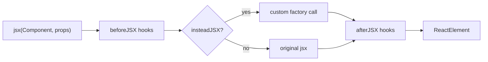

## React runtime (`@valenced/react`)

Valenced binds to Discord's React instances as they initialize:

```ts
import {
    React, ReactNative, ReactJSXRuntime,
    ReactModuleId, ReactNativeModuleId, ReactJSXRuntimeModuleId,
} from '@valenced/react'
```

In plugin source code, import directly from `'react'` or `'react-native'`. Bundlers map these imports to Valenced's captured instances. Module IDs can be passed to [`withDependencies` filters](/docs/plugin-development/api-reference/modules#withdependencies-fingerprinting).

<Callout type="warn">
    React is unavailable during `preInit`. Do not render components or call hooks before `init`.
</Callout>

## JSX runtime patching (`@valenced/react/jsx-runtime`)

Intercept React element creation across the entire component tree. This allows modifying component props or child nodes without finding or wrapping render functions directly.

```ts
import { beforeJSX, afterJSX, insteadJSX } from '@valenced/react/jsx-runtime'
```

### `beforeJSX(type, hook)`

Runs before an element of `type` is created. Receives `[type, props, key]` and returns modified arguments:

```ts
beforeJSX(ProfileBadgeRows, args => {
    const [, props] = args
    props.badges.push(myBadge)
    return args
})
```

### `afterJSX(type, hook)`

Runs after element creation. Receives the created `ReactElement` and returns the final element (or `null`):

```ts
afterJSX(ProfileBadgeRows, element => {
    return element
})
```

### `insteadJSX(type, hook)`

Replaces the JSX factory invocation. Receives `([type, props, key], originalFactory)`:

```tsx
insteadJSX(SomeComponent, ([type, props, key], jsx) => {
    return jsx(MyReplacement, props, key)
})
```

All three methods return unpatch functions that can be passed directly to `cleanup()`.



## Fiber utilities (`@valenced/utils/react`)

Utilities for inspecting and modifying React fiber node trees:

```ts
import { findInReactFiber } from '@valenced/utils/react'

const image = findInReactFiber(
    element,
    (node): node is ReactElement<ImageProps> => node.type === Image,
)
if (image) image.props.style = [image.props.style, myStyle]
```

### Example: nested component patching

Patching rendered output one level deep:

```tsx
afterJSX(ProfileBadgeRows, el => {
    const unpatch = afterJSX(el.type, rendered => {
        unpatch()
        const container = findInReactFiber(rendered, isBadgeContainer)
        container?.props.children.push(<MyBadge />)
        return rendered
    })
    return el
})
```
