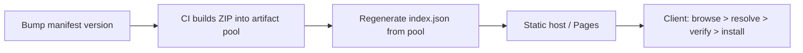

## Distribution model

Valenced distributes plugins through static plugin repositories. A repository consists simply of an `index.json` manifest served over HTTPS, hosted alongside a pool of packaged plugin ZIP files. Because it is completely static, you can host your repository on almost any static file hosting service, such as GitHub Pages, Cloudflare Pages, Vercel, or an Amazon S3/Cloudflare R2 bucket.

The `index.json` file catalogs all available plugins, their published versions, direct artifact download URLs, SHA-256 integrity checksums, file sizes, dependencies, and release channel pointers (`latest`, `beta`, etc.).

Users add your repository URL directly inside the Valenced app (**Settings > Valenced > Plugins**, tap the settings gear), and then discover and install your plugins from the in-app **Browse Plugins** catalog. When installing, the client fetches the index, resolves required dependencies, and verifies SHA-256 hashes before extracting files to disk.



## Publishing with the plugin template

The [plugin template](/docs/plugin-development/getting-started/the-plugin-template) includes pre-configured GitHub Actions workflows that automate releases directly from your commit history. Releases are driven entirely by your plugin manifests:

1. **Bump the version:** Increment the `version` field in your plugin's `manifest.json` and merge the changes into your default branch (`main`).
2. **Release planning:** The CI workflow runs [`plan-releases`](/docs/plugin-development/cli/plan-releases) to compare your local manifests against the versions currently published in your artifact pool. It automatically guards against accidental version downgrades or malformed version strings.
3. **Packaging and publishing:** For every newly planned version, CI compiles the plugin, copies the packaged archive into the pool as `<id>@<version>.zip`, and runs [`generate-index`](/docs/plugin-development/cli/generate-index) to rebuild `index.json`. Both the new artifacts and the updated index are pushed to your deployment branch in a single atomic commit.

### The pool branch

In the template, all published artifacts live in an isolated deployment branch (by default, `gh-pages`), organized into a `pool/` directory alongside `index.json`. This pool stores the cumulative record of every plugin version you have ever released.

Git tags and GitHub releases are still generated alongside your builds to provide convenient release notes and changelog anchors.

Because CI only updates the pool when a build succeeds completely, a failed CI run won't publish broken or partial states. Re-running the release workflow is always safe.

The generated `index.json` includes channel pointers calculated automatically:

- **`latest`:** The highest version without a prerelease label (e.g. `1.2.0`).
- **`beta`:** The newest version overall, included only when it is newer than `latest` (e.g. `1.3.0-beta`).
- **Custom channels:** Custom channel pointers pinned via `repo.config.json` (such as `lts` or holding back `latest`).

Users pick a channel to follow, or stay on one version, from the plugin's options in the app. A plugin follows its install channel by default, which is `latest` unless the user picked another.

## Repository configuration

You can customize how your repository is published using two optional GitHub Actions repository variables. Set them in your GitHub repository under **Settings > Secrets and variables > Actions > Variables**:

| Variable | Default | Description |
| --- | --- | --- |
| `POOL_BRANCH` | `gh-pages` | The Git branch where `pool/` and `index.json` are committed and served from. |
| `PAGES_BASE_URL` | `https://<owner>.github.io/<repo>` | The public root URL prepended to all artifact links in `index.json`. |

<Callout title="Custom domains and alternative static hosts">
    If you serve your GitHub Pages branch using a custom domain (e.g. `https://plugins.example.com`) or host the deployment branch on Cloudflare Pages or a custom server, set `PAGES_BASE_URL` to your public website origin without a trailing slash.
</Callout>

### Repository metadata and channel overrides (`repo.config.json`)

To name your repository, add a description, or pin custom release channels, place a `repo.config.json` file in the root of your project:

```json title="repo.config.json"
{
    "name": "My Plugin Repository",
    "description": "Custom plugins maintained for Valenced.",
    "icon": "https://example.com/icon.png",
    "channels": {
        "dev.you.plugin-name": {
            "latest": "1.1.4",
            "lts": "1.0.9"
        }
    }
}
```

Channel overrides configured here always take precedence over automatically calculated pointers. They must point to a version that exists in your published pool:

- **Rolling back a release:** If a newly published version has a critical issue, point `latest` back to an earlier stable version in `repo.config.json` without having to delete the artifact from your pool.
- **Maintaining LTS or targeted channels:** Create custom channels like `lts` that users can select if they prefer long-term stability over frequent updates.

Whenever you edit `repo.config.json`, simply push your changes or run the publish workflow to regenerate `index.json`.

## Sideloading and manual distribution

If you prefer not to host a public repository, you can distribute built `.zip` archives directly to users. Users can install them manually via **Install from file** in the repository settings (**Settings > Valenced > Plugins**, tap the settings gear) using Android's file picker.

Keep in mind that sideloaded plugins have no repository backing them, so they cannot check for updates or update automatically.

## Versioning best practices

- **Follow [Valenced version formatting](/docs/plugin-development/getting-started/the-plugin-template#version-format):** Use dotted integers with an optional alphanumeric label (e.g. `1.2.0`, `2.0`, or `1.3.0-beta1`). Version range constraints like `^` and `~` are not supported.
- **Never reuse or lower version numbers:** Valenced checks for updates by comparing version strings. Lowering a version will be rejected as a downgrade by `plan-releases`.
  If you republish a version with a different artifact, clients that installed the old artifact see it as an update, since Valenced also compares SHA-256 hashes.
- **Keep dependency ranges honest:** When an update falls outside an installed dependent's version range, users see a warning that it breaks that plugin. Release dependent updates with widened ranges alongside breaking library updates.
- **Keep plugin IDs permanent:** Changing a plugin's ID treats it as a brand-new plugin, breaking update paths and stored settings for existing users.
- **Background updates:** Updates are downloaded to disk in the background and applied seamlessly the next time Discord restarts.
- **Maintain storage schema compatibility:** When updating plugins that use `jsonStorage`, ensure your code handles missing or legacy fields from previous versions.

## Guidelines for public repositories

Plugins shared on community or public repositories should follow these core principles:

1. **Open source:** Plugins should provide public source code for review and auditing.
2. **User privacy:** Never collect telemetry, analytical data, or user information without explicit opt-in consent.
3. **No API abuse:** Features that automate user accounts (self-bots), scrape Discord data, or harvest authentication tokens are strictly prohibited.
4. **Clean teardown:** Always clean up hooks, subscriptions, and patches in your `stop()` lifecycle, or call `plugin.requireReload()` if a change requires an app restart to undo.
5. **Inline or Discord-native icons:** Manifest icons must be valid Discord asset names or inline `data:` URIs. Remote icon URLs are stripped during validation.
