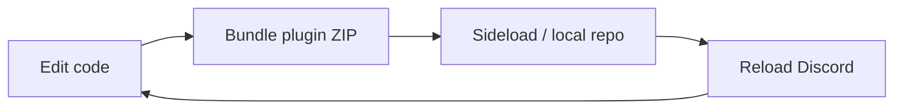

## Development loop



### 1. Build and install

Run your plugin template build to produce a plugin ZIP. Push it to your device and install it with **Install from file** in the repository settings (**Settings > Valenced > Plugins**, tap the settings gear). Valenced validates the ZIP before confirmation.

Alternatively, serve your build directory as a local repository:

```sh
bun run serve                 # http://<lan-ip>:8080
```

For emulators or USB-connected devices blocking cleartext LAN traffic, use ADB port forwarding:

```sh
bun run serve -- --base-url http://127.0.0.1:8080
adb reverse tcp:8080 tcp:8080
```

Add the printed URL as a repository in Valenced settings to install and update from your local build server.

### 2. Iterate

The initial installation of a plugin ID installs in a disabled state. Enable it from the plugin card.
Subsequent builds overwrite the plugin artifact on disk without mutating running memory. Reload the app to apply changes.

With a local repository, you don't need to bump the version for every build. Valenced compares the artifact's SHA-256 hash too, so a rebuilt ZIP with the same version shows up as an update. Tap **Check for updates** in the repository settings to pick it up.

### 3. Reload

Trigger an app reload from DevTools or the console:

```js
valenced.discord.native.BundleUpdaterManager.reload()
```

## Using DevTools

[Valenced DevTools](/docs/devtools) provides remote REPL access and file watching:

```sh
revenge-devtools --watch ./dist
```

Connect in **Settings > Valenced > Developer > Connect to DevTools** (default: `localhost:7864`). From the server REPL:

- Evaluate expressions directly on the client: `valenced.modules.finders.lookupModule(...)`
- Inspect module exports and test filters interactively.
- Configure automatic reload triggers on build changes:

```text
> .setting server.watch.command "valenced.discord.native.BundleUpdaterManager.reload()"
```

## Debug builds

When testing against a local Valenced bundle build, use `deno run build --dev`. Debug builds:

- Log lifecycle phases (`PREINIT`, `INIT`, `START`), module finds, module lookup failures.
- Warn on malformed filters.
- Log other development hints.

<Callout>
    It is generally recommended to do plugin development against a debug build. They include debug logs, developer hints, and generally don't have behavioral differences.
    But regardless, test your code on production builds too.
</Callout>

## Verification checklist

- [ ] Plugin starts and stops cleanly without errors or leaked patches.
- [ ] No failed module lookups in debug logs.
- [ ] Settings persist across client restarts.
- [ ] Clean install succeeds without pre-existing storage.
